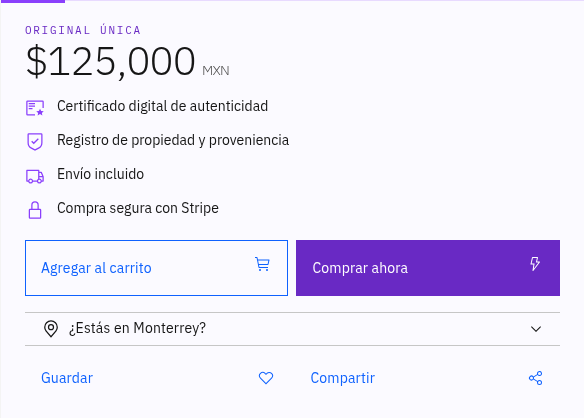
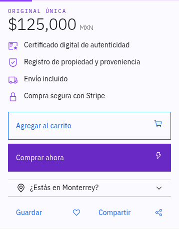
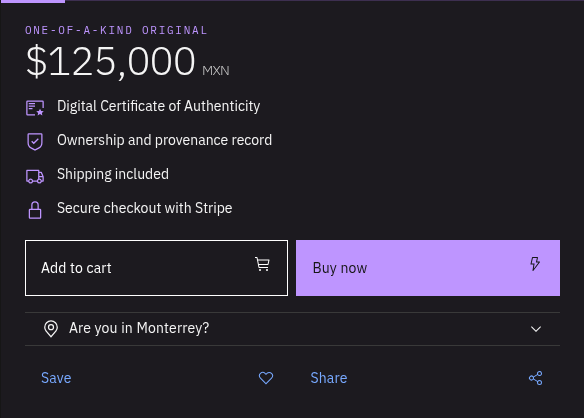
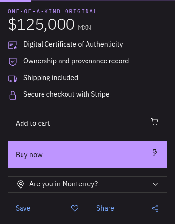
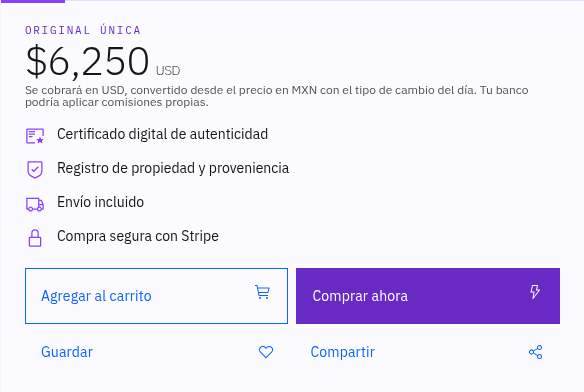

# Phase 2: global market and purchase experience

## Audit and architecture

Phase 1 is merged in base commit `3095ce7`. This phase reuses `site_settings.global_shipping_countries`, category defaults, reusable policies, `allowed_shipping_countries`, the effective-country resolver, `resolveCartShipping`, existing Stripe session preparation, verified payment snapshots, and existing artwork/order/print models. No shipping tables, product records, price lists or checkout implementations are duplicated.

Before this change the country was a catalog URL filter, product purchase text was a single certificate/provenance sentence, and Buy Now embedded the local-payment selector and Monterrey promotion inside one purchase-grid cell. This produced uneven button cells. ShippingSummary also displayed zero amounts for included shipping and did not follow the displayed transaction currency.

The implementation adds:

- `MarketProvider` and `MarketSelector`, using Phase 1's enabled country list. Public navigation, the landing header and collector header share a searchable Carbon country dialog. ISO codes and localized names are searchable; Carbon owns focus management and Escape dismissal.
- A necessary shopping preference cookie, `jbu-market`, shared by server and client. Signed-in selections also use the existing Supabase Auth metadata (`jbu_market`) without modifying product or profile tables. Browser persistence works for guests and authenticated users; account restoration is validated against currently enabled markets.
- Catalog/prints/series server reads use the market cookie when there is no explicit country filter. A concrete country URL adopts that market. `country=ALL` explicitly preserves browsing all countries without clearing or bypassing the purchase market. Other URL filters remain unchanged.
- Existing server session preparation reads the selected country and intersects it with authoritative current products and settings. The current market is sent with direct, cart and resumed checkout attempts. Old pending-session fingerprints already include destination and policies, so incompatible sessions cannot be reused.
- Existing cart validation reports incompatibility with the selected market rather than offering an unsupported checkout. Cart contents are preserved when the market changes.
- `PurchaseBenefits`, `ShippingBenefit`, and `usePurchaseShipping` consume the shared resolver. Originals show separate certificate and provenance benefits, shipping, and Stripe security. Open prints do not gain original ownership or certificates. Limited/hand-finished/signed benefits require actual supported configuration; LIMITED alone does not imply hand embellishment or a certificate. Digital items never receive physical shipping benefits.
- Original purchase actions use responsive intrinsic columns and equal 56px button heights. Buy Now stays primary. Its local information and error display no longer stretch the other purchase button. Existing offer/save/share callbacks are retained.
- `LocalDeliveryInfo` uses an accessible Carbon accordion below the purchase buttons. Authentication and registration remain in the existing flows. Advance-payment enquiries reuse the configured existing inquiry channel.

## Country, language, currency and future pricing

These remain separate concepts:

| Concept | Current behavior |
| --- | --- |
| Country | Persistent enabled shipping destination; governs availability and shipping. No geolocation or automatic market expansion. |
| Language | Existing browser/account/manual language logic. Selecting a country does not switch the language. |
| Currency | Mexico suggests MXN; other enabled countries suggest the existing approved USD conversion. Existing manual currency controls remain independent within a market. A new market resets that market suggestion. |
| Product price | Existing authoritative MXN catalog price and the existing cached exchange-rate service. No numeric amount is relabelled and no new country-specific prices are invented. |
| Future price list | No new schema or pretend price list is introduced. Authoritative pricing remains in the existing checkout currency/pricing service, where a future approved country-price lookup can be added. |

Only MXN and USD are currently supported. Selecting Sweden does **not** invent a SEK price. If no authoritative USD exchange rate is available, the existing formatter and checkout fall back to MXN. Shipping uses the same charged currency and conversion utility as the product. The Stripe summary remains authoritative before payment.

Clearing the market returns to browsing without a chosen destination; the Phase 1 destination dialog still handles differing policies before session creation. That dialog now persists its selection and updates the currency suggestion. Country preferences are never trusted as product eligibility, pricing or authorization.

## Local delivery and payment on delivery

`localPurchaseCapabilities` extends the existing local-delivery module; it does not define new address, appointment or payment rules. The compact information appears only for Mexico, a physical original with an existing supported delivery category, enabled local service, and compatible ARTIST fulfillment under an included/local-delivery arrangement. Prodigi, external providers, prints, digital items, unsupported markets and missing policies do not automatically gain local delivery.

Local delivery and payment on delivery are separate flags. A paid local-delivery policy can offer coordination while requiring advance payment. The existing payment-on-delivery order RPC has no shipping-fee contract, so it is offered only for approved zero-charge local arrangements. Paid shipping stays in Stripe; this change never silently waives a configured fee. A carrier fixed-rate policy alone is not approval for local delivery; assign an appropriate local policy if required.

The server validates these capabilities again for local quote/create requests. Existing address/municipality validation, appointments, reservations, verified authentication, ownership, inventory and confirmation rules remain authoritative. The interface explicitly says that address and appointment eligibility must be confirmed. Local enquiries for advance-paid delivery reuse `artwork_inquiries` and the site's configured channel. No live message was sent during implementation testing.

## Shipping presentation

- INCLUDED: localized “Shipping included”, with no redundant zero amount.
- FIXED_RATE: actual charge formatted in the transaction currency.
- Different destination options with no market: “Shipping based on destination”.
- QUOTE_REQUIRED: localized quote-required message and existing request action; ordinary original checkout is unavailable until an applicable arrangement exists.
- BUYER_ARRANGED: buyer transportation responsibility, including any configured handling fee; never described as free transportation.
- Local/pickup: explicit configured method.
- Estimates: only configured minimum/maximum business-day values, presented as estimates.

Open/limited print benefits remain distinct. No hand finishing, signature, numbering or digital certificate is inferred from marketing text or fabricated for an unsupported edition.

## Verification

Final results: **97/97 Node logic/regression tests**, **17/17 database regression tests**, **17/17 browser cases**, TypeScript and the full Webpack production build passed. All five existing crawler/history/production/comments/print-sharing HTML checks also passed against a fresh isolated fixture.

Automated Node coverage includes market parsing, invalid countries, URL browsing versus purchase market, server destination enforcement, currency semantics, benefit differences, shipping labels, local/provider eligibility and fee-safe local payment. Existing shipping, currency, catalog, delivery, print and social tests are retained. Database regressions exercise the existing shipping snapshots and atomic print/order behavior.

Browser tests run the real production build against the isolated Supabase REST fixture, using actual Chromium:

- 320, 390, 768 and 1440px; light/Spanish and dark/English at each width.
- Equal primary button heights, mobile stacking, no horizontal overflow and no redundant included-shipping zero.
- Keyboard activation of local information and Escape dismissal of the market dialog.
- Mexico → Sweden → refresh → catalog → Mexico: persistent destination, converted currency, and local information hidden/shown appropriately.
- Authenticated checkout request contains the selected destination/currency; authenticated collectors are not prompted to register.
- Fixed shipping and estimates, quotation blocking, buyer-arranged shipping, supplier exclusions, advance-paid local delivery, missing-policy blocking and missing-FX fallback.

The browser checkout endpoint is intercepted after validating its request: no test payment or production order is created. Actual Stripe Hosted Checkout visual/payment acceptance still requires the configured staging account. No physical screen reader or real mobile hardware was used; screen-reader semantics, native controls, keyboard interaction and responsive browser viewports were checked. Production credentials and customer data were not used.

### Screenshots

These show the existing **Example** test artwork and test-only market/rate configuration. They do not change production prices, artworks or enabled destinations.

| Desktop | Mobile |
| --- | --- |
|  |  |
|  |  |

Machine-readable browser results are saved alongside the screenshots.

### Reproduce

Use the repository's existing installation strategy (the inherited lockfile mismatch is unchanged). Run the Node tests with the standard runner. For the optional browser scripts, install Playwright in a separate temporary tooling directory rather than adding a runtime application dependency, and supply `PLAYWRIGHT_MODULE` and `CHROMIUM_PATH` if needed.

1. Start `tests/mockSupabaseSocial.mjs` with a chosen `PORT`.
2. Build/start a test instance with the same dummy credentials and isolated Supabase URL used by the existing social CI. Use `NEXT_FONT_GOOGLE_MOCKED_RESPONSES=<absolute repo>/tests/nextFontResponses.cjs` for deterministic real IBM Plex assets in CI.
3. Set `JBU_TEST_SITE` to the running app and `JBU_TEST_SUPABASE` to that fixture, then run `tests/marketPurchase.browser.cjs` and `tests/marketShipping.browser.cjs`.
4. Run the existing crawler/history/production/comments/print-sharing HTML checks against the test instance as well. Keep a production build stable during browser capture; do not hot-reload source while collecting results.

## Rollout and rollback

No database migration is required. Phase 1's shipping migration/configuration must already be present. Review enabled destinations and policies in the existing Admin area; do not enable new markets as part of deployment. Existing unrestricted products inherit those settings automatically.

Deploy the application normally, then smoke-test both guest and collector sessions, market persistence, legacy country URLs, local eligibility, and actual staging Stripe checkout. Verify existing authentication, inventory, edition and order behavior. Do not change prices, branding, payment methods or fulfillment flags merely to enable the selector.

Rollback by restoring the previous application deployment. Added Auth metadata and preference cookies are inert for the old code and can be retained or cleared. No product/order data or Phase 1 shipping snapshots should be deleted. Existing paid orders remain immutable. Open Stripe sessions retain their previously frozen shipping arrangement under the existing lifecycle.

## Known limits

- Supported transaction/display currencies remain MXN and USD; other local currencies and real country price lists require a future authoritative pricing implementation.
- Postal-restricted Hosted Checkout delivery retains Phase 1's safe block; local address/appointment verification stays in the existing local workflow.
- Account preference writes use existing Supabase Auth metadata; browser persistence works even if a network failure prevents account synchronization. Live cross-device account restoration must be smoke-tested in staging.
- Existing repository lint errors remain outside this change. No new lint errors were introduced; an existing local-delivery hook-dependency warning also identifies the new local-only prop.
- There is no new guest-original, cash-on-delivery, quotation, carrier or supplier subsystem.

## Modified and added files

- `app/(account)/layout.jsx`
- `app/ClientLayout.jsx`
- `app/api/inquiries/route.js`
- `app/api/local-delivery/route.js`
- `app/artwork/[sku]/ArtworkDetail.module.css`
- `app/artwork/[sku]/ArtworkDetailClient.tsx`
- `app/artwork/[sku]/ArtworkDetailPage.jsx`
- `app/cart/page.jsx`
- `app/catalog/CatalogClient.tsx`
- `app/landing/LandingClient.jsx`
- `app/layout.tsx`
- `app/prints/PrintCollection.jsx`
- `components/AskForPriceButton.jsx`
- `components/BuyButton.jsx`
- `components/CartDrawer.jsx`
- `components/CartShippingNotice.jsx`
- `components/CurrencyProvider.jsx`
- `components/Navbar.tsx`
- `components/delivery/PaymentDelivery.jsx`
- `components/market/MarketProvider.jsx`
- `components/market/MarketSelector.jsx`
- `components/market/MarketSelector.module.css`
- `components/purchase/LocalDeliveryInfo.jsx`
- `components/purchase/LocalDeliveryInfo.module.css`
- `components/purchase/PurchaseBenefits.jsx`
- `components/purchase/PurchaseBenefits.module.css`
- `components/shipping/ShippingBenefit.jsx`
- `components/shipping/ShippingProvider.jsx`
- `components/shipping/ShippingSummary.jsx`
- `components/shipping/usePurchaseShipping.js`
- `context/CartContext.jsx`
- `docs/global-market-purchase-experience.md`
- `docs/phase2-screenshots/desktop-dark.png`
- `docs/phase2-screenshots/desktop-light.png`
- `docs/phase2-screenshots/mobile-dark.png`
- `docs/phase2-screenshots/mobile-light.png`
- `docs/phase2-screenshots/results.json`
- `docs/phase2-screenshots/shipping-results.json`
- `docs/phase2-screenshots/sweden-shipping.png`
- `lib/catalogData.server.js`
- `lib/catalogUrl.js`
- `lib/checkoutCurrency.server.js`
- `lib/checkoutShipping.server.js`
- `lib/checkoutShipping.server.test.js`
- `lib/countryAvailability.test.js`
- `lib/localDelivery.js`
- `lib/localDelivery.server.js`
- `lib/market.js`
- `lib/market.server.js`
- `lib/market.test.js`
- `lib/publicPrintDiscovery.server.js`
- `lib/purchaseBenefits.js`
- `tests/marketPurchase.browser.cjs`
- `tests/marketShipping.browser.cjs`
- `tests/mockSupabaseSocial.mjs`
- `tests/verifyHistoricalPrintHtml.mjs`
