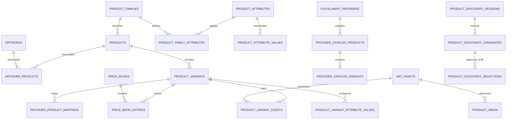

# Independent product platform

## Audit and migration order

Artwork records own the artistic identity, version links, ownership, certificates and provenance. The ordinary Stripe route accepts ORIGINAL and PRINT, validates prices on the server, and freezes the identifiers and amount in checkout metadata. Numbered physical editions use separate reservation and certificate paths. Managed print variants, galleries and private production revisions already exist. The checkout route has no digital-download item type. Digital products can be drafted here and require a delivery integration before sale.

1. Apply the additive schema after the shipping-country and print-gallery migrations. Run the mapping in a staging database and compare legacy identifiers and prices. Backfill creates commercial mirrors and one MXN reference book, without moving historical orders or inventory.
2. Keep existing artwork/print checkout and its verified Stripe fulfillment authoritative. The imported price entries are reference snapshots. Legacy managers remain the writer for existing retail prices and stock. This release does not implement dual-write.
3. Use Product Manager and Product Studio for independent commercial drafts. Before activating an independent checkout, validate country selection, payment currency, returns, availability, inventory and tax. Freeze the selected configuration, price entry and shipping/tax amounts at server checkout. Only a verified paid order should enter the approval queue.
4. Compare both paths before retiring any legacy fields. Existing order lines and certificates retain their original references.

Rollback before independent checkout is introduced consists of reverting application changes and retaining the new private tables. Disable access to the affected admin routes first if the migration must be rolled back. Export independent drafts, quotes and approval records before removing the new tables. No legacy public routes or columns need to be dropped.

## Relationships

## Provider integration

| Capability | Gelato | Prodigi |
| --- | --- | --- |
| Discovery | Product API v3 catalogs, paged product search and product detail. Text matching runs over each retrieved catalog page. | Print API v5 paged categories, products, text search and product variants. The catalogue variant ID and supplier SKU are stored separately. |
| Quotes | Orders API v4 quote. Manufacturing and qualified shipping methods come from the returned quote. Gelato's quoted response lacks a separate tax component. | Print API v5 order quote. JBU retains the supplier currency and reported manufacturing, shipping, and tax. |
| Fulfillment | Orders API v4 create and get. The durable JBU claim prevents automatic resubmission when the response is uncertain. | Print API v5 create and get. Submission sends the durable job ID as the documented idempotency key. |
| Production inputs | Operators verify the default print area and matching derivative against the supplier template. | JBU requires the documented variant metadata to identify a single required default area. |

Provider contracts were checked against [Gelato Product API](https://dashboard.gelato.com/docs/products/catalog/list/), [Gelato Orders API](https://dashboard.gelato.com/docs/orders/v4/quote/) and the [Prodigi Print API v5 reference](https://www.prodigi.com/print-api/reference/v5/).

Catalog access needs the server-only `GELATO_API_KEY` and `PRODIGI_API_KEY` for the corresponding adapters. Supplier calls have fixed hosts, no redirect following, bounded response size and a request timeout. A supplier rate limit is returned with its retry hint. Search is admin-only and fetched on demand. Saved candidates retain supplier specifications and their capture time for later review. Scheduled refresh, webhook ingestion and provider-generated mockups are deferred. Studio presents the linked artwork photograph as a source reference.

Quotes expire after 15 minutes in JBU. Use a representative destination address for product research. JBU persists the country, supplier identifiers, selected attributes, quantity, currency and amounts. The discovery address is used to request the quote and omitted from the persisted record. Provider availability and manufacturing prices vary by destination, attributes and account. An unreported tax component requires an explicit estimate before a pricing proposal can be calculated.

## Pricing authority

Prices are stored as integer minor units in the book's currency. The seeded draft books cover MX/MXN, US/USD, CA/CAD, GB/GBP and SE/SEK. On resolution, an active variant must allow the requested country. The resolver filters active entries and books by validity windows, currency and channel, ranks country-specific books ahead of global books, then ranks segment-specific books and higher priority within those groups. A tie returns an ambiguity instead of a price. An expired or unmatched selection returns unavailable. Legacy references are excluded from resolution. Original price references follow the Stripe endpoint's base-price-first rule. Managed variants retain their legacy print amounts.

For example, a manufacturing quote of 600, shipping of 300 and tax of 100 minor units produces a 1,250 minor-unit proposal at 20% gross margin. Markup, target margin, minimum margin and manual amounts each retain their assumptions. Currency conversions require a named, dated FX input expressed as target minor units per source minor unit. Studio can record a manual FX input in the proposal. For Prodigi, unsupported requested quote currencies are omitted so Prodigi uses its configured account currency. JBU shows the returned currency. A price draft with recorded assumptions requires explicit approval, and a price book requires explicit activation. Existing Stripe checkout continues to read legacy records and makes no supplier API calls.

## Operations and authorization

The TypeScript-compatible Zod contracts are in `lib/productCatalog/contracts.js`. The admin transport uses `POST /api/admin/product-catalog` with `{operation, input}`. A normal signed-in session is required. The server verifies the role from the user's JWT before using the service account. An AI client can use the same contracts through a scoped tool broker, with authenticated actor identity and explicit approval outside the model. Supplier keys, private object paths, signed URLs and customer data are never returned to public or AI clients.

| Mode | Operation and required context |
| --- | --- |
| Read | `artworkSearch` by query, `artworkAssets` by artwork UUID, `list` and `productDetails` by product UUID |
| Read | `categories`, `searchCatalog` and `inspectProduct` by provider and its IDs, with bounded pagination |
| Read | `listSessions`, `resumeSession` by UUID, `resolvePrice` by variant/country/currency, `proposePrice` by quote/currency/policy |
| Draft | `createSession`, `addCandidate`, `validateCompatibility` and `quoteCandidate`. Quote requests write a time-limited record. Confirmed printable dimensions, bleed and minimum DPI are compared with the selected asset's pixel dimensions. Optional supplier attributes must match supported values or a listed combination. |
| Draft | `createDraft`, `editProduct`, `addVariant`, `setVariantAttribute`, `setVariantCountries`, `linkArtwork`, `addArtworkPhoto`, `registerProductionAsset`, `linkProviderCandidate`, `addBookDraft`, `addPriceDraft` |
| Protected | `reviewProduct`, `approvePrice`, `activateBook`, `enableMapping`, `prepareFulfillment`, `approveFulfillment`, `submitFulfillment`. All require an administrator and `confirm: true`. |
| Fulfillment status | `listFulfillment` reads private records, while `syncFulfillment` refreshes a submitted order's stored supplier status. |

Discovery saves candidates independently of products. Draft creation derives the internal product and variant, linkage and disabled supplier mapping transactionally. A selection is unique to its session candidate and supplier configuration. Editors can review a proposal and send an independent draft into pending review. Public independent product activation and checkout cutover are deferred until commercial readiness validation covers stock, shippability, tax, retail price and payment.

## Fulfillment and recovery

Production submission defaults to disabled. The server requires `ENABLE_PRODUCT_PROVIDER_SUBMISSION=true` in addition to separate authenticated approval and submission actions. Only a paid Stripe legacy print item with a ready production preparation can enter this workflow. The derivative must match that immutable preparation revision, remain private and belong to the mapped artwork. Use `quoteFulfillment` to request shipping against the private paid order address. Approval requires a current quote for that job, provider, variant, configuration, quantity, unchanged destination and a specific shipping method. The claim rechecks the paid order, supplier mapping, revision and quote before signing a short-lived production URL. The supplier receives the address from the paid order and the production currency from the approved quote. No scheduled job automatically submits an order.

If supplier submission succeeds but JBU cannot confirm the response, inspect the supplier dashboard using the job UUID as the merchant reference. Resolve jobs in `submitting` or `reconciliation_required` with verified provider evidence before authorizing any replacement. Dropping these records would discard the protection against duplicate production. Historical orders and customer-facing status continue through the existing order path.

## Future CPQ integration

A future Configure service can build rule evaluation on family attribute definitions, typed variant values and exact supplier configurations. Add versioned constraints and configuration snapshots so an editable configuration can be evaluated without mutating existing variants. The Price service can then consume the selected configuration, segment, channel, market, shipping, tax, an approved retail entry and any authorized pricing adjustments. A future Quote aggregate should store versioned lines, configuration, currency, price and shipping snapshots, expiration and acceptance, document and commercial approval records. Recheck mutable availability and payment on conversion, while retaining the original priced snapshot. The current discovery quote is a supplier cost observation and carries no customer commitment. No autonomous agent or CPQ engine runs in this release.

## Verification scope

Local tests apply the migrations to PostgreSQL-compatible fixtures, rerun the legacy import, exercise eligibility and single-claim fulfillment, and assert supplier request shapes with HTTP fixtures. The source contracts establish which capabilities each adapter can attempt. Live accounts, country availability and orders require provider credentials and separate verification. No live quotes, orders or production migrations are part of this implementation review.

## Wall art studio

The Gelato wizard is available under **Product Studio → Create wall art with Gelato**. It keeps a single artwork in context through product selection, mockups, bilingual descriptions, pricing by market, and batch review. It uses JBU's Carbon admin layout and is optimized for desktop, with wrapping grids and a horizontally scrollable price table on small screens.

Gelato's public Product API returns catalogues and product variants. JBU classifies wall art from supplier identifiers and titles, filters out unrelated products even when returned within a mixed catalogue, and groups UIDs that differ by dimensions and orientation into product series. Unknown families are omitted. The initial batch limit is six products and twelve variants. A market is a country and currency from an available price book.

Construction estimates use Gelato's single-unit Product Price endpoint with country and currency only. The estimate is tied to the exact UID, quantity, country and currency and rounded up to the relevant minor unit. When the provider omits a matching cost, there is no suggested margin price for that variant. Shipping and tax remain pending at discovery. The paid-order fulfillment flow still requires a separate address-based quote. [Gelato Product Price API](https://dashboard.gelato.com/docs/products/prices/)

The gallery and wall scenes are JBU compositions using the artwork's public preview. JBU saves the preview source, framing choice, scene selection and primary scene on each variant and renders them in Product Manager. These are preview recipes. Supplier renders, standalone export files and production derivatives have separate requirements.

Migration `20261212_wall_art_studio.sql` saves the complete batch in one transaction and returns the same product IDs on a retry for the same workspace. It saves product and variant drafts, disabled provider mappings, and any explicitly entered draft prices. It neither publishes the batch nor sends supplier orders. Apply the migration before enabling this release in staging. Prodigi remains available through general Product Studio discovery. Its dedicated wizard remains a later integration.
